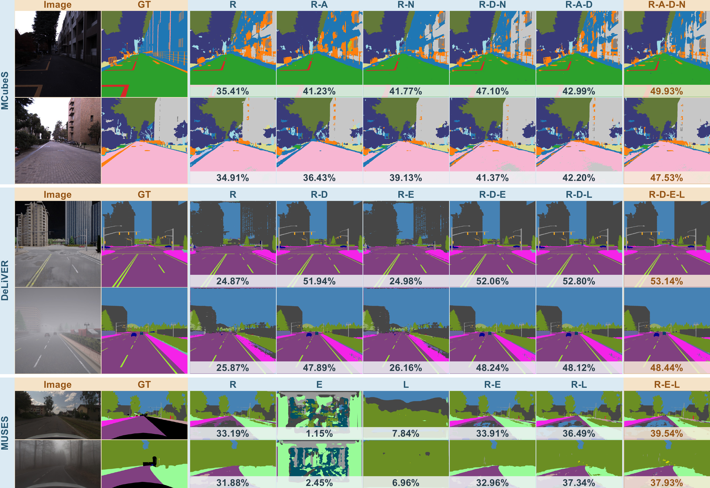

# CrossWeaver: Cross-modal Weaving for Arbitrary-Modality Semantic Segmentation

## Abstract

Multimodal semantic segmentation leverages complementary sensing cues to improve scene understanding when appearance alone is ambiguous. Despite progress in feature fusion, effectively integrating heterogeneous observations remains challenging because their relevance varies across spatial regions and sensing conditions. Image-level modality importance does not fully capture the information required at individual prediction locations. Missing or degraded inputs further complicate this process by changing the complementary evidence available during inference. We propose CrossWeaver, a framework that couples target-dependent cross-modal interaction with spatially coherent feature aggregation. Its Modality Interaction Block constructs source-specific context conditioned on the target representation and adaptively combines contributions from different modalities. Seam-Aligned Fusion consolidates the interaction-enhanced features into a multiscale representation for dense prediction. Experiments on MCubeS, DeLiVER, and MUSES yield full-input mean intersection over union scores of 48.76%, 64.69%, and 53.19%, respectively. Subset and degradation evaluations further show that modalities with weak standalone performance can provide complementary information, while source allocation varies with input quality.

## Installation

Use Python 3.10 with PyTorch 2.1.0 and CUDA 11.8.

```bash
git clone https://github.com/Zayne111/CrossWeaver.git
cd CrossWeaver

conda create -n crossweaver python=3.10 -y
conda activate crossweaver
python -m pip install torch==2.1.0 torchvision==0.16.0 --index-url https://download.pytorch.org/whl/cu118
python -m pip install numpy==1.24.1 Pillow==9.4.0 PyYAML==6.0 opencv-python==4.8.1.78 \
  einops==0.3.0 fvcore==0.1.5.post20221221 tabulate==0.9.0 tqdm==4.65.2 \
  tensorboard==2.11.2 matplotlib==3.6.3
```

Run the following commands from the repository root.

## Datasets

- **MCubeS:** a multimodal material segmentation dataset with RGB, AoLP, DoLP, and NIR observations. [Download](https://drive.google.com/file/d/14egTCyC0Pampb7imrXVwaDRffHN7FZxh/view) · [Dataset repository](https://github.com/kyotovision-public/multimodal-material-segmentation).
- **DeLiVER:** a multimodal semantic segmentation dataset with RGB, Depth, Event, and LiDAR observations, covering different weather conditions and sensor degradations. [Download](https://huggingface.co/datasets/InSAI-Lab/DELIVER) · [Dataset repository](https://github.com/InSAI-Lab/DELIVER).
- **MUSES:** a multimodal driving-scene dataset with RGB, Event, LiDAR, and Radar observations under diverse sensing conditions. [Download](https://muses.ethz.ch/MUSES_packages/) · [Dataset repository and preprocessing tools](https://github.com/timbroed/MUSES).

Extract the datasets and set `DATASET.ROOT` in the corresponding configuration:

| Dataset | Configuration |
| --- | --- |
| MCubeS | `configs/mcubes.yaml` |
| DeLiVER | `configs/deliver.yaml` |
| MUSES | `configs/muses.yaml` |

## Model Zoo

| Dataset | Input modalities | Checkpoint |
| --- | --- | --- |
| MCubeS | RGB, AoLP, DoLP, NIR | [Download](https://github.com/Zayne111/CrossWeaver/releases/download/v0.1/crossweaver_mcubes.pth) |
| DeLiVER | RGB, Depth (HHA), Event, LiDAR | [Download](https://github.com/Zayne111/CrossWeaver/releases/download/v0.1/crossweaver_deliver.pth) |
| MUSES | RGB, Event, LiDAR (R-E-L) | [Download](https://github.com/Zayne111/CrossWeaver/releases/download/v0.1/crossweaver_muses.pth) |

## Evaluation

```bash
PYTHONPATH=. python tools/validation.py --cfg configs/mcubes.yaml
PYTHONPATH=. python tools/validation.py --cfg configs/deliver.yaml
PYTHONPATH=. python tools/validation.py --cfg configs/muses.yaml
```

## Training

Download the ImageNet-pretrained MiT-B0 backbone from [SegFormer](https://github.com/NVlabs/SegFormer#training) and set `MODEL.PRETRAINED` to its path. The default location is `checkpoints/pretrained/segformer/mit_b0.pth`.

Set `DATASET.ROOT`, `TRAIN.BATCH_SIZE`, and `TRAIN.EPOCHS`, then launch training with:

```bash
PYTHONPATH=. torchrun --standalone --nproc_per_node=1 tools/train.py --cfg configs/mcubes.yaml
PYTHONPATH=. torchrun --standalone --nproc_per_node=1 tools/train.py --cfg configs/deliver.yaml
PYTHONPATH=. torchrun --standalone --nproc_per_node=1 tools/train.py --cfg configs/muses.yaml
```

## Visualization


